<!--
  01 极光终端 / v3 整页版
  仓库：2778582993/2778582993
  依赖：assets/01-aurora-page.svg（必须一起提交）
  说明：整页是一张 900×1200 的动画 SVG，没有分段卡片；GitHub 会清洗 CSS/JS，但  里的 SVG 动画仍会播放。
  项目：SVG 里是视觉索引；整张图外层链到 Repositories，具体点击走下方原生链接（ 内 SVG 链接在 GitHub 上不可点）。
  回退：README-v2-cards.md 是上一版分段卡片，assets/01-aurora-hero.gif 也保留。
-->

  

<strong>PROJECT LINKS</strong> 
<a href="https://github.com/2778582993/SpicyLove99"><strong>SpicyLove99</strong></a> <code>TypeScript</code>&nbsp;★2
&nbsp;·&nbsp;
<a href="https://github.com/2778582993/chat_ai"><strong>chat_ai</strong></a> <code>JavaScript</code>&nbsp;★1
 
<a href="https://github.com/2778582993/yuz"><strong>yuz</strong></a> <code>TypeScript</code>&nbsp;★1
&nbsp;·&nbsp;
<a href="https://github.com/2778582993/dsh-purge"><strong>dsh-purge</strong></a> <code>JavaScript</code>&nbsp;fork
 
<a href="https://github.com/2778582993?tab=repositories">all repositories →</a>

