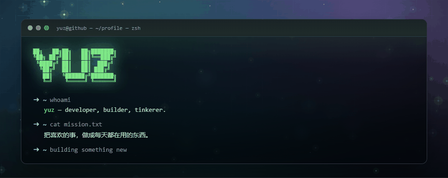

<!--
  01 极光终端 / Aurora Terminal — 可落地版（含动画 hero）
  仓库：2778582993/2778582993
  依赖：assets/01-aurora-hero.gif（必须一起提交）
  说明：GitHub 会清洗 CSS/JS，动效由 GIF 承载；其余卡片由 github-readme-stats / activity-graph 自动生成。
  如果不想提交 4 MB GIF，改用同目录的 README-lite.md。
-->

developer · builder · tinkerer &nbsp;·&nbsp; 把喜欢的事，做成每天都在用的东西。

<table border="0">
<tr>
<td></td>
<td></td>
</tr>
</table>

FEATURED &nbsp;·&nbsp;
<a href="https://github.com/2778582993/SpicyLove99">SpicyLove99</a> &nbsp;·&nbsp;
<a href="https://github.com/2778582993/chat_ai">chat_ai</a>

© 2026 yuz · built with coffee &amp; curiosity